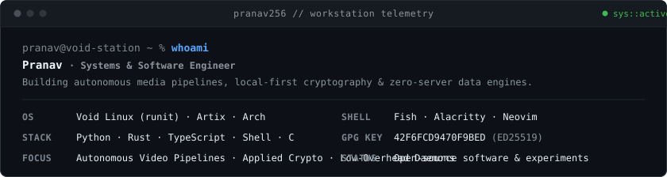
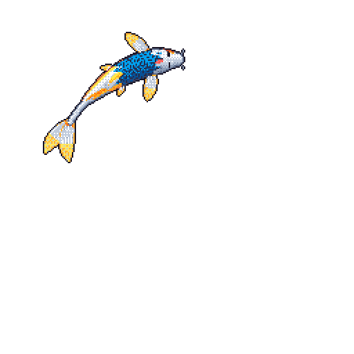

  

  

### Featured Systems & Architecture

<table>
  <tr>
    <td width="50%" valign="top">
      <a href="https://github.com/pranav256/Hooky"><b>Hooky</b></a> &nbsp;<code>Python</code> <code>Multimodal AI</code>
      
AI-assisted video clipper for vertical 9:16 shorts. Transcribes audio with Faster-Whisper, detects highlights with Gemini, and renders animated subtitles via FFmpeg.

      <small><code>FastAPI</code> · <code>Faster-Whisper</code> · <code>Gemini Pro</code> · <code>OpenCV</code></small>
    </td>
    <td width="50%" valign="top">
      <a href="https://github.com/pranav256/Password-Manager"><b>Password Manager</b></a> &nbsp;<code>Rust</code> <code>Applied Cryptography</code>
      
Encrypted desktop password vault written in Rust. Uses Argon2id key derivation and AES-256-GCM authenticated encryption with a native egui GUI.

      <small><code>Rust</code> · <code>Argon2id</code> · <code>AES-256-GCM</code> · <code>egui</code></small>
    </td>
  </tr>
  <tr>
    <td width="50%" valign="top">
      <a href="https://github.com/pranav256/news-api"><b>News API</b></a> &nbsp;<code>Python</code> <code>Data Architecture</code>
      
Automated news aggregator refreshed every 2 hours via GitHub Actions. Ingests, normalizes, and serves static JSON feeds with open CORS.

      <small><code>Python</code> · <code>GitHub Actions</code> · <code>jsDelivr CDN</code> · <code>Edge Cache</code></small>
    </td>
    <td width="50%" valign="top">
      <a href="https://github.com/pranav256/config"><b>Dotfiles & Workstation</b></a> &nbsp;<code>Shell</code> <code>Unix Systems</code>
      
Workstation configuration for Void Linux, Artix, and Arch. Centered on Neovim with Lua config, Fish shell, Alacritty, and Pywal color theming.

      <small><code>Void Linux</code> · <code>runit</code> · <code>Neovim</code> · <code>Fish</code> · <code>Alacritty</code></small>
    </td>
  </tr>
</table>

 

### Engineering Stack

| Domain | Technologies & Tooling |
| :--- | :--- |
| **Languages** | Python, Rust, TypeScript, JavaScript, Shell (Bash / Fish), C, SQL |
| **Systems & Linux** | Void Linux (runit init), Arch Linux, Artix Linux, Docker, Linux Kernel Tuning |
| **Media & Multimodal AI** | Faster-Whisper (local STT), Google Gemini API, OpenCV (Haar Cascades, Video Processing), FFmpeg |
| **Security & Cryptography** | Argon2id (memory-hard KDF), AES-256-GCM (authenticated encryption), PGP / GPG (`42F6FCD9470F9BED`) |
| **Frontend & Web** | React, Next.js, TypeScript, Tailwind CSS, Broadsheet Reader Engines |
| **Developer Environment** | Neovim (Lua), Alacritty, Fish Shell, Tmux, Git, Pywal |

 

### Open-Source Tools & Experiments

- [**news-react**](https://github.com/pranav256/news-react) & [**news-api-web**](https://github.com/pranav256/news-api-web): Broadsheet editorial reader and interactive developer documentation portal for the News API data engine.
- [**Octane-Browser**](https://github.com/pranav256/Octane-Browser): Custom lightweight desktop web browser built in Python and Qt.
- [**Car-and-Pedestrian-Detector**](https://github.com/pranav256/Car-and-Pedestrian-Detector): Real-time road object classifier using OpenCV Haar cascades.
- [**Space-Duel**](https://github.com/pranav256/Space-Duel): 2D arcade physics combat game built in Python and Pygame.

 

### Identity & Verification

- **GitHub:** [@pranav256](https://github.com/pranav256)
- **PGP Fingerprint:** [`42F6FCD9470F9BED`](https://github.com/pranav256.gpg) `(ED25519 · Verified)`
- **Email:** `pranav628@proton.me`
